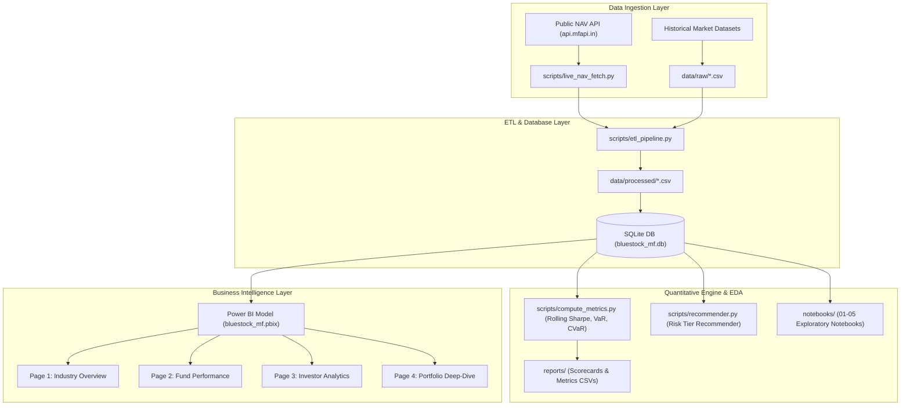
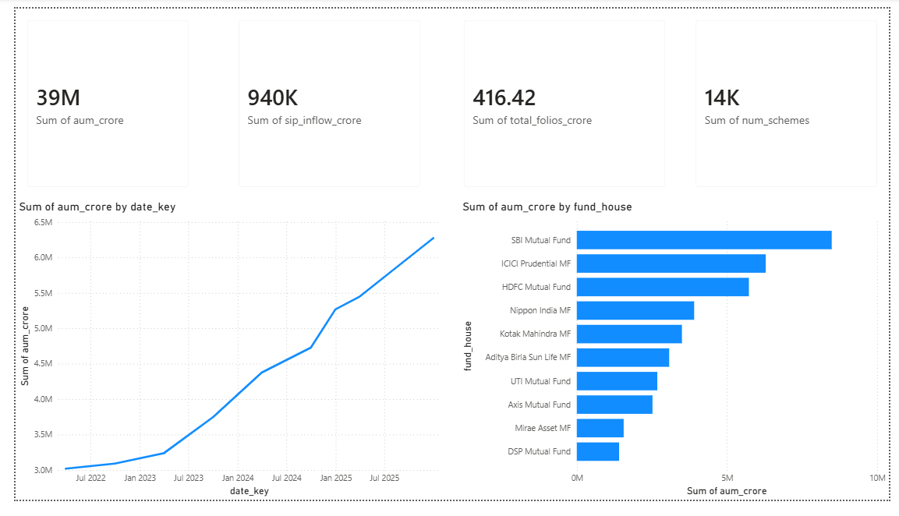
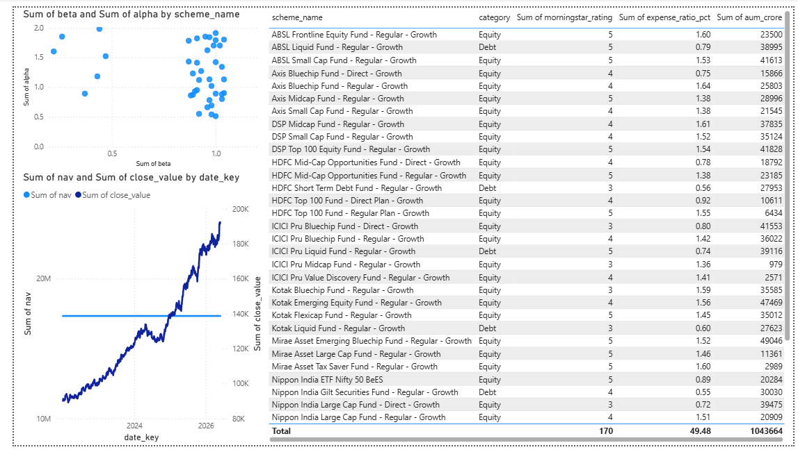
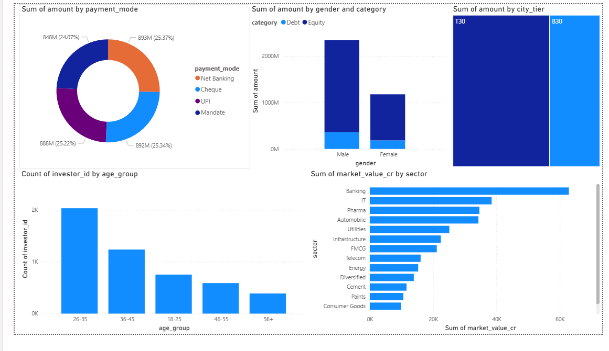
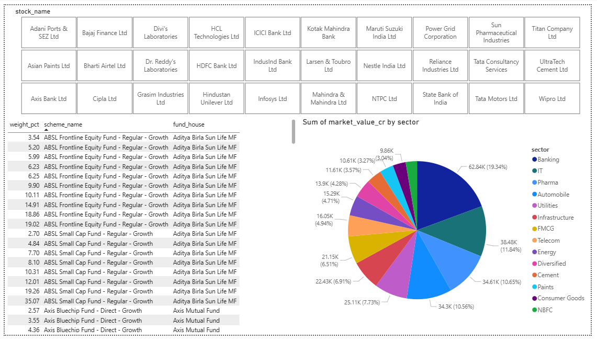

<div align="center">

# Bluestock Mutual Fund & Portfolio Analytics

<p>End-to-end mutual fund ETL pipeline, quantitative risk analytics, and interactive 4-page Power BI business intelligence dashboard</p>


</div>

---


Retail and institutional investors often face fragmented data when evaluating mutual fund performance, systemic risk exposures, and underlying stock allocations across fund houses. This project solves that challenge by establishing a repeatable end-to-end analytics workflow: ingesting live and historical fund datasets, computing mathematical risk-adjusted return indicators, and storing structured relational models in SQLite. The compiled star-schema data model powers an interactive 4-page Power BI dashboard delivering deep visibility across macroeconomic metrics, risk-versus-return profiles, investor demographics, and underlying equity holdings.

---


- **Orchestrated ETL & Database Staging**: Automated pipeline (`etl_pipeline.py`, `rebuild_db.py`) that processes raw fund data and loads structured tables directly into an operational SQLite database (`bluestock_mf.db`).
- **Live Net Asset Value (NAV) Ingestion**: Custom fetcher module (`live_nav_fetch.py`) consuming the public `api.mfapi.in` REST endpoint for real-time NAV records across premier Indian mutual fund schemes.
- **Quantitative Risk & Alpha Computation**: Automated computational scripts (`compute_metrics.py`) calculating rolling 252-day annualised Sharpe ratios (anchored to RBI repo rate proxies) and historical 95% Value-at-Risk (VaR) / Conditional VaR (CVaR).
- **Rule-Based Fund Recommendations**: Query utility (`recommender.py`) dynamically filtering and presenting top mutual fund allocations aligned to investor risk appetite tiers (Low, Medium, High).
- **4-Page Production Power BI Dashboard**: Interactive BI workbook (`bluestock_mf.pbix`) built on a Star Schema with custom DAX measures for macro AUM trends, risk-return scatter plots, demographic treemaps, and stock-level cross-filtering.

---


| Layer | Technology |
|---|---|
| **Core Language** | Python 3.10+ |
| **Data Processing & Analytics** | Pandas, NumPy, SciPy (`scipy.stats`) |
| **Relational Database** | SQLite (`bluestock_mf.db`), SQL DDL Schema |
| **Business Intelligence** | Microsoft Power BI Desktop (`bluestock_mf.pbix`), DAX |
| **Exploratory Data Analysis** | Jupyter Notebooks, Matplotlib, Seaborn, Plotly |
| **Data Ingestion** | Requests (`api.mfapi.in` REST API) |

---




---


### Prerequisites
- Python 3.10 or higher
- Microsoft Power BI Desktop (to view and interact with `.pbix` dashboard)
- Git

### 1. Clone the Repository
```bash
git clone https://github.com/tejas-coder28/Mutual-Fund-Capstone-Project.git
cd Mutual-Fund-Capstone-Project
```

### 2. Environment Setup & Dependencies
```bash
# Create and activate virtual environment
python -m venv venv

# Windows (Command Prompt / PowerShell)
.\venv\Scripts\activate

# macOS / Linux
source venv/bin/activate

# Install required dependencies
pip install -r requirements.txt
```

### 3. Environment Variables
No API tokens or secret keys are required. All live data pulls use free public endpoints, and all data operations run against the local SQLite database.

### 4. Run the Pipeline & Analytics
```bash
# Rebuild the SQLite database from cleaned CSV files
python scripts/etl_pipeline.py --rebuild

# Compute rolling Sharpe ratios and historical 95% VaR / CVaR metrics
python scripts/compute_metrics.py

# Run fund risk-tier recommendations
python scripts/recommender.py

# (Optional) Fetch updated live NAV values from public API
python scripts/live_nav_fetch.py
```

### 5. Launch the Dashboard
Open [`dashboard/bluestock_mf.pbix`](file:///C:/Users/Tejas/Desktop/Mutual-Fund-Capstone-Project/dashboard/bluestock_mf.pbix) using Microsoft Power BI Desktop to inspect the interactive report pages.

---


```
Mutual-Fund-Capstone-Project/
├── dashboard/
│   └── bluestock_mf.pbix                 # 4-page interactive Power BI production dashboard
├── data/
│   ├── db/bluestock_mf.db                # SQLite relational database holding dimensions and facts
│   └── processed/                        # Cleaned CSV files (NAV history, AUM, holdings, SIPs)
├── docs/
│   └── assets/                           # High-resolution dashboard page screenshots
├── notebooks/
│   ├── 01_data_ingestion.ipynb           # Source ingestion prototyping
│   ├── 02_data_cleaning.ipynb            # Missing value imputation & schema standardization
│   ├── 03_eda_analysis.ipynb             # Exploratory analysis & statistical distribution checks
│   ├── 04_performance_analytics.ipynb    # Alpha, beta & benchmark comparison evaluations
│   └── 05_advanced_analytics.ipynb       # VaR, CVaR & rolling Sharpe computations
├── reports/                              # Generated metrics summaries, scorecards, and final slide deck
├── scripts/
│   ├── compute_metrics.py                # Rolling Sharpe, VaR, and CVaR computational script
│   ├── data_cleaning_and_loading.py      # Raw dataset transformation and SQLite table loader
│   ├── data_ingestion.py                 # Staging ingestion driver
│   ├── etl_pipeline.py                   # Master ETL pipeline orchestrator
│   ├── generate_eda_charts.py            # Static exploratory visualization generator
│   ├── live_nav_fetch.py                 # Live NAV retrieval module via mfapi.in
│   ├── rebuild_db.py                     # SQLite database reconstructor from processed CSVs
│   └── recommender.py                    # Risk-profile-based fund recommendation engine
├── sql/
│   ├── queries.sql                       # Analytical business intelligence SQL queries
│   └── schema.sql                        # Relational database DDL table schema definitions
├── data_dictionary.md                    # Entity definitions and column data dictionary
├── requirements.txt                      # Project Python library requirements
├── LICENSE                               # MIT License
└── README.md                             # Project documentation
```

---


### 1. Industry Overview
*Tracking macro-level KPIs, total Assets Under Management (AUM), and fund category asset allocations.*



### 2. Fund Performance Analytics
*Evaluating fund performance via dynamic Risk vs. Return scatter plots and multi-axis NAV vs. Benchmark timelines.*



### 3. Investor Behavior & Demographics
*Non-additive distinct investor demographics by age brackets, payment methods, and geographic flows (T30 vs. B30).*



### 4. Portfolio Deep-Dive
*Interactive equity holding slicer allowing real-time stock exposure cross-filtering across mutual funds.*



---


- **Automated Workflow Orchestration**: Integrate Apache Airflow or GitHub Actions cron runners to automate the daily `live_nav_fetch.py` ingestion and database sync.
- **Predictive NAV & Volatility Modeling**: Implement ARIMA / Prophet time-series models to forecast volatility corridors and short-term NAV directional trends.
- **Automated Power BI Service Refresh**: Configure an on-premises data gateway or REST push dataset integration for cloud-hosted dashboard continuous refreshes.

---


**Tejas Muralidhar**
- GitHub: [@tejas-coder28](https://github.com/tejas-coder28)
- LinkedIn: [Tejas Muralidhar](https://www.linkedin.com/in/tejasmuralidhar)
